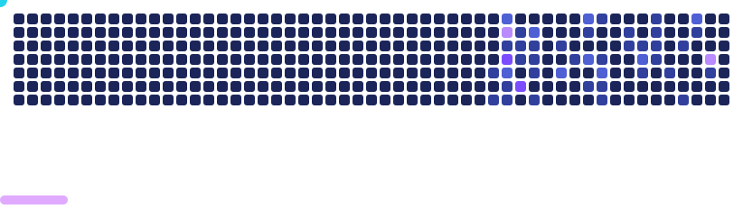

# Roei Mashraki

Backend engineer with 2.5 years at an AI startup, building FastAPI services, evaluation tooling, and data workflows.  Since 2023, developing independent backend and AI projects focused on reliable testing, automation, and production-ready workflows.

**Open to backend and AI infrastructure roles.**

 &nbsp; mashraki.work@gmail.com

---

## VisionDiff

A/B regression testing for vision-language models. Run a baseline and a candidate over the same dataset through LM Studio and get a statistical verdict instead of a vibe.

`Python 3.12` `FastAPI` `SQLAlchemy 2.0` `React 19` `TypeScript` `NVML`

## Slice Overflow

Full-stack ordering platform built to production conventions.

`Python 3.12` `async FastAPI` `PostgreSQL` `React 19` `Stripe` `Docker`

## DepthConverter

Offline 2D to 3D SBS conversion for VR headsets. Upscaling, monocular depth estimation and GPU stereo synthesis in one local pipeline, no cloud uploads.

`Python 3.12` `PyTorch CUDA` `PySide6` `FFmpeg (x265, NVENC)` `uv`

## HoneyTunnel

Peer-to-peer screen sharing with voice, chat and file transfer. End-to-end encrypted over QUIC, with no accounts and no servers.

`Rust` `Tokio` `QUIC` `Direct3D 11` `Media Foundation` `Opus` `egui`

## Technical Skills

**Backend** Python, SQL, FastAPI, asyncio, SQLAlchemy, Pydantic, Alembic, REST APIs, OAuth 2.0 
**Data & delivery** PostgreSQL, MongoDB, AWS (S3, CloudWatch, SQS), Docker, pytest, Git, GitLab CI/CD 
**AI tooling** Claude, Codex, Hugging Face, ComfyUI, LoRA training (ai-toolkit), local LLM inference for coding (Qwen, DeepSeek, Gemma). Generative image, video and 3D models (Wan, LTX, MiniMax, Tripo3D). 
**Frontend** TypeScript, React, Tailwind CSS, Vite

---

